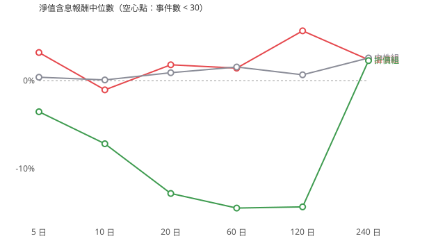

## 附錄：2003–2019 年（MoneyDJ 淨值）

主分析（2020 年起）的樣本太少，所以另外看 2020 年以前的年份，當作一份獨立樣本。設定和主分析相同，只差淨值來源：這段期間沒有抓官方淨值，用 MoneyDJ；2020 年起兩者逐日比對 69,489 筆，只有 6 筆差異超過 0.005 元。

**結果：只有 28 個事件（溢價 4、中性 22、折價 2），三組都樣本不足。** 這 4 個溢價事件的報酬沒有比較差，超額報酬在各視窗都略為正，方向和假說相反。當時已下市的 ETF 不在今天的清單裡，可能有存活者偏差（未驗證）。

## 設定

- 淨值來源：MoneyDJ；期間 20030101～20191231
- 下跌：含息淨值相對近 10 日最高 ≤ -8%；溢價 ≥ +0.8%、中性 ±0.3%、折價 ≤ -0.5%
- 近 60 日均量 ≥ 5,000 張（事件日往回算）；同一檔 20 個交易日內只取第一個事件
- 事件：溢價 4、中性 22、折價 2（明細 events.csv）
- 報酬單位：%；「超額」= 淨值含息報酬 − 同期加權報酬指數；檢定：Mann-Whitney U（常態近似），95% 區間以「事件日期」為單位重抽（同一天的事件共用同一個市場，不能當獨立樣本）

## 主表（main_table.csv）

| 組 | N 日 | 事件數 | 不同日期 | 淨值含息中位數% | 平均% | 勝率% | 市價含息中位數% | 超額中位數% | 超額勝率% | 最大回撤中位數% |  |
|---|---|---|---|---|---|---|---|---|---|---|---|
| 溢價 | 5 | 4 | 4 | +3.21 | +2.27 | +75.00 | +2.29 | +0.22 | +50.00 | -2.13 | 樣本不足 |
| 溢價 | 10 | 4 | 4 | -1.04 | -1.57 | +50.00 | -2.27 | +0.41 | +100.00 | -6.35 | 樣本不足 |
| 溢價 | 20 | 4 | 4 | +1.81 | +2.26 | +100.00 | +0.41 | +0.66 | +100.00 | -6.92 | 樣本不足 |
| 溢價 | 60 | 4 | 4 | +1.43 | -0.76 | +75.00 | +0.67 | +0.91 | +75.00 | -10.41 | 樣本不足 |
| 溢價 | 120 | 4 | 4 | +5.67 | +6.10 | +75.00 | +4.14 | +1.27 | +75.00 | -10.86 | 樣本不足 |
| 溢價 | 240 | 4 | 4 | +2.39 | +5.38 | +50.00 | +1.11 | +1.02 | +75.00 | -11.36 | 樣本不足 |
| 中性 | 5 | 22 | 22 | +0.40 | +0.73 | +54.55 | +0.10 | +0.20 | +72.73 | -3.03 | 樣本不足 |
| 中性 | 10 | 22 | 22 | +0.09 | +0.14 | +50.00 | -0.27 | +0.38 | +63.64 | -4.60 | 樣本不足 |
| 中性 | 20 | 22 | 22 | +0.91 | +0.63 | +50.00 | +0.56 | +0.06 | +54.55 | -6.90 | 樣本不足 |
| 中性 | 60 | 22 | 22 | +1.56 | -0.49 | +50.00 | +1.56 | -0.79 | +45.45 | -12.14 | 樣本不足 |
| 中性 | 120 | 22 | 22 | +0.67 | +0.50 | +54.55 | +0.56 | -0.65 | +31.82 | -14.63 | 樣本不足 |
| 中性 | 240 | 22 | 22 | +2.58 | +1.33 | +59.09 | +2.57 | -2.40 | +27.27 | -25.73 | 樣本不足 |
| 折價 | 5 | 2 | 2 | -3.53 | -3.53 | +50.00 | -2.94 | -3.23 | +0.00 | -8.45 | 樣本不足 |
| 折價 | 10 | 2 | 2 | -7.17 | -7.17 | +0.00 | -6.38 | -4.15 | +0.00 | -9.17 | 樣本不足 |
| 折價 | 20 | 2 | 2 | -12.82 | -12.82 | +0.00 | -12.77 | -6.14 | +0.00 | -17.79 | 樣本不足 |
| 折價 | 60 | 2 | 2 | -14.48 | -14.48 | +0.00 | -14.05 | -1.20 | +50.00 | -27.52 | 樣本不足 |
| 折價 | 120 | 2 | 2 | -14.35 | -14.35 | +50.00 | -14.27 | -12.01 | +0.00 | -29.92 | 樣本不足 |
| 折價 | 240 | 2 | 2 | +2.28 | +2.28 | +50.00 | +2.93 | -13.05 | +0.00 | -29.92 | 樣本不足 |

## 溢價組 vs 對照組（淨值含息報酬）

| 溢價組 vs | N 日 | 溢價 n | 對照 n | 中位數差% | 95% 下界 | 95% 上界 | p 值 |  |
|---|---|---|---|---|---|---|---|---|
| 折價 | 5 | 4 | 2 | +6.74 | -0.90 | +12.52 | +0.25 | 樣本不足 |
| 折價 | 10 | 4 | 2 | +6.12 | +1.95 | +8.42 | +0.11 | 樣本不足 |
| 折價 | 20 | 4 | 2 | +14.63 | +3.67 | +26.49 | +0.11 | 樣本不足 |
| 折價 | 60 | 4 | 2 | +15.91 | +3.26 | +22.53 | +0.25 | 樣本不足 |
| 折價 | 120 | 4 | 2 | +20.02 | -0.62 | +41.51 | +0.25 | 樣本不足 |
| 折價 | 240 | 4 | 2 | +0.11 | -12.79 | +18.99 | +0.82 | 樣本不足 |
| 中性 | 5 | 4 | 22 | +2.81 | -1.53 | +4.71 | +0.24 | 樣本不足 |
| 中性 | 10 | 4 | 22 | -1.14 | -7.49 | +5.05 | +0.86 | 樣本不足 |
| 中性 | 20 | 4 | 22 | +0.90 | -2.13 | +4.82 | +0.64 | 樣本不足 |
| 中性 | 60 | 4 | 22 | -0.13 | -14.78 | +11.82 | +0.92 | 樣本不足 |
| 中性 | 120 | 4 | 22 | +5.00 | -6.36 | +17.78 | +0.55 | 樣本不足 |
| 中性 | 240 | 4 | 22 | -0.19 | -15.39 | +27.42 | +0.75 | 樣本不足 |

## 補充：把折溢價當連續變數（所有下跌事件，對超額報酬）

| N 日 | 事件數 | Spearman ρ | 95% 下界 | 95% 上界 |
|---|---|---|---|---|
| 5 | 30 | +0.15 | -0.26 | +0.52 |
| 10 | 30 | +0.21 | -0.23 | +0.56 |
| 20 | 30 | +0.24 | -0.16 | +0.55 |
| 60 | 30 | +0.23 | -0.19 | +0.52 |
| 120 | 30 | +0.27 | -0.19 | +0.60 |
| 240 | 30 | +0.36 | -0.01 | +0.64 |

