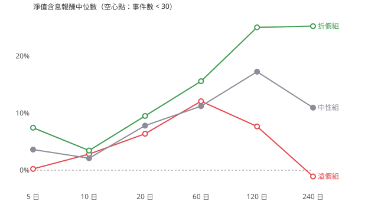

## 結論（2026-10-25）

**資料不支持假說。** 跌勢中出現溢價的台股 ETF，事後扣掉大盤的報酬並沒有比較差；20～60 日視窗也沒有出現假說預期的差距。唯一和假說一致的，是溢價本身的回歸：溢價組 5 日的市價報酬比淨值報酬少約 2%。但主設定下溢價組只有 12 個事件，分布在 6 個日期，要到 20 日以上視窗只剩 8 個（5 個日期），**樣本不足，以下都只能當描述，不能當結論。**

細節：

- **原始報酬看起來溢價組較差，但那是時點造成的。** 淨值含息報酬中位數，溢價組比折價組低：5 日 −7.2%、20 日 −3.1%、60 日 −3.5%。只有 5 日這一項的 95% 區間不含 0。
  - 折價組 20 個事件有 11 個落在 2025-04-07～09（關稅崩盤的底部），之後全面反彈；
  - 換成**超額報酬**（扣掉同期加權報酬指數），溢價組反而比折價組好：60 日 +8.1%，區間 +0.6～+10.0；跟中性組比則差不多（20 日 +0.8%、60 日 +1.6%，區間都含 0）。
- **20～60 日的差距不存在。** 溢價組 vs 中性組的淨值報酬中位數差：20 日 −1.4%（區間 −11.5～+2.7）、60 日 +0.9%（−15.3～+4.8）。
- **溢價回歸只在很短的期間、而且很小。**
  - 溢價組 5 日的市價報酬中位數 −1.70%，淨值是 +0.24%，差約 2%，符合「溢價回歸只貢獻 1～2%」的前半句；
  - 把折溢價當連續變數（所有下跌事件，176 筆）：5 日 Spearman ρ = −0.26（區間 −0.49～+0.05），方向一致但不顯著；
  - 60～240 日反而轉正（ρ +0.30～+0.54，區間都含 0），和假說相反。
- **穩健性方向不一致**（詳見 robustness.md）：
  - 下跌門檻 −5% 時，溢價組較差（20 日 vs 折價 −7.3%，區間 −12.4～−0.2）；
  - −12%、均量 1,000 張、排除主動式、2025 年後，差距都接近 0 或轉正；
  - 2023–2024 年完全沒有溢價事件。
- **2003–2019 年附錄**（MoneyDJ 淨值，獨立樣本）：溢價 4 筆、折價 2 筆，溢價組反而較好，同樣樣本不足。

**為什麼樣本這麼少**：近 60 日均量 ≥ 5,000 張的國內股票型 ETF，2020 年前只有少數幾檔；跌 8% 又同時溢價 ≥ 0.8% 本來就少見（造市機制通常把折溢價壓在 ±0.5% 內）。而且同一天常有好幾檔一起觸發，獨立的「下跌波段」只有 5～6 個。要真正檢驗，需要更長的期間或更多市場（例如美股、日股 ETF），不是調門檻能解決的。

**未驗證／限制**：
- 淨值與收盤價來自公開資訊觀測站（官方），和 MoneyDJ 比對 69,489 筆，只有 6 筆差異超過 0.005 元。
- 配息來自 FinMind，未逐筆和投信公告核對（未驗證）。
- 附錄的 2003–2019 年用 MoneyDJ 淨值，沒有官方淨值可對；當時已下市的 ETF 可能有漏（存活者偏差，未驗證）。

## 設定

- 淨值來源：公開資訊觀測站（官方）；期間 20200101～至今
- 下跌：含息淨值相對近 10 日最高 ≤ -8%；溢價 ≥ +0.8%、中性 ±0.3%、折價 ≤ -0.5%
- 近 60 日均量 ≥ 5,000 張（事件日往回算）；同一檔 20 個交易日內只取第一個事件
- 事件：溢價 12、中性 130、折價 20（明細 events.csv）
- 報酬單位：%；「超額」= 淨值含息報酬 − 同期加權報酬指數；檢定：Mann-Whitney U（常態近似），95% 區間以「事件日期」為單位重抽（同一天的事件共用同一個市場，不能當獨立樣本）

## 主表（main_table.csv）

| 組 | N 日 | 事件數 | 不同日期 | 淨值含息中位數% | 平均% | 勝率% | 市價含息中位數% | 超額中位數% | 超額勝率% | 最大回撤中位數% |  |
|---|---|---|---|---|---|---|---|---|---|---|---|
| 溢價 | 5 | 12 | 6 | +0.24 | +0.42 | +50.00 | -1.70 | +0.37 | +66.67 | -3.37 | 樣本不足 |
| 溢價 | 10 | 8 | 5 | +2.83 | +1.57 | +62.50 | +1.25 | +1.64 | +75.00 | -10.72 | 樣本不足 |
| 溢價 | 20 | 8 | 5 | +6.40 | +4.19 | +62.50 | +3.97 | +1.11 | +75.00 | -10.90 | 樣本不足 |
| 溢價 | 60 | 8 | 5 | +12.10 | +9.87 | +87.50 | +10.45 | +1.13 | +62.50 | -11.75 | 樣本不足 |
| 溢價 | 120 | 3 | 3 | +7.68 | +1.30 | +66.67 | +3.89 | +1.11 | +66.67 | -8.35 | 樣本不足 |
| 溢價 | 240 | 3 | 3 | -1.08 | +14.04 | +33.33 | -3.97 | +0.19 | +66.67 | -19.14 | 樣本不足 |
| 中性 | 5 | 116 | 47 | +3.62 | +3.95 | +75.86 | +3.55 | +0.55 | +57.76 | -2.67 | — |
| 中性 | 10 | 110 | 46 | +2.11 | +3.33 | +63.64 | +2.41 | -0.06 | +47.27 | -5.73 | — |
| 中性 | 20 | 110 | 46 | +7.82 | +6.59 | +77.27 | +7.40 | +0.32 | +54.55 | -8.94 | — |
| 中性 | 60 | 104 | 43 | +11.23 | +16.17 | +90.38 | +11.18 | -0.50 | +45.19 | -12.10 | — |
| 中性 | 120 | 65 | 30 | +17.27 | +22.97 | +84.62 | +16.42 | +0.65 | +55.38 | -14.55 | — |
| 中性 | 240 | 49 | 24 | +10.97 | +18.95 | +87.76 | +11.76 | -1.79 | +42.86 | -22.32 | — |
| 折價 | 5 | 20 | 8 | +7.45 | +6.54 | +100.00 | +8.01 | +0.32 | +60.00 | -6.61 | 樣本不足 |
| 折價 | 10 | 20 | 8 | +3.46 | +6.45 | +95.00 | +4.33 | +1.37 | +70.00 | -6.61 | 樣本不足 |
| 折價 | 20 | 20 | 8 | +9.52 | +9.98 | +100.00 | +10.09 | -1.03 | +30.00 | -7.06 | 樣本不足 |
| 折價 | 60 | 18 | 6 | +15.60 | +18.38 | +100.00 | +15.68 | -6.98 | +22.22 | -7.12 | 樣本不足 |
| 折價 | 120 | 16 | 5 | +25.04 | +28.33 | +100.00 | +22.45 | -13.59 | +25.00 | -7.51 | 樣本不足 |
| 折價 | 240 | 14 | 4 | +25.25 | +36.43 | +100.00 | +26.28 | -44.00 | +7.14 | -9.52 | 樣本不足 |

## 溢價組 vs 對照組（淨值含息報酬）

| 溢價組 vs | N 日 | 溢價 n | 對照 n | 中位數差% | 95% 下界 | 95% 上界 | p 值 |  |
|---|---|---|---|---|---|---|---|---|
| 折價 | 5 | 12 | 20 | -7.20 | -11.19 | -0.25 | +0.00 | 樣本不足 |
| 折價 | 10 | 8 | 20 | -0.63 | -13.12 | +1.64 | +0.15 | 樣本不足 |
| 折價 | 20 | 8 | 20 | -3.12 | -14.64 | +1.11 | +0.05 | 樣本不足 |
| 折價 | 60 | 8 | 18 | -3.50 | -24.96 | +4.69 | +0.19 | 樣本不足 |
| 折價 | 120 | 3 | 16 | -17.36 | -64.89 | +0.08 | +0.08 | 樣本不足 |
| 折價 | 240 | 3 | 14 | -26.33 | -59.74 | +26.53 | +0.23 | 樣本不足 |
| 中性 | 5 | 12 | 116 | -3.38 | -8.16 | +0.33 | +0.02 | 樣本不足 |
| 中性 | 10 | 8 | 110 | +0.72 | -6.58 | +3.68 | +0.60 | 樣本不足 |
| 中性 | 20 | 8 | 110 | -1.42 | -11.48 | +2.72 | +0.37 | 樣本不足 |
| 中性 | 60 | 8 | 104 | +0.87 | -15.31 | +4.76 | +0.88 | 樣本不足 |
| 中性 | 120 | 3 | 65 | -9.59 | -43.03 | +6.29 | +0.18 | 樣本不足 |
| 中性 | 240 | 3 | 49 | -12.05 | -22.25 | +37.29 | +0.43 | 樣本不足 |

## 補充：把折溢價當連續變數（所有下跌事件，對超額報酬）

| N 日 | 事件數 | Spearman ρ | 95% 下界 | 95% 上界 |
|---|---|---|---|---|
| 5 | 176 | -0.26 | -0.49 | +0.05 |
| 10 | 157 | -0.12 | -0.35 | +0.14 |
| 20 | 157 | +0.06 | -0.14 | +0.20 |
| 60 | 148 | +0.30 | -0.05 | +0.48 |
| 120 | 100 | +0.32 | -0.20 | +0.56 |
| 240 | 76 | +0.54 | -0.03 | +0.66 |

